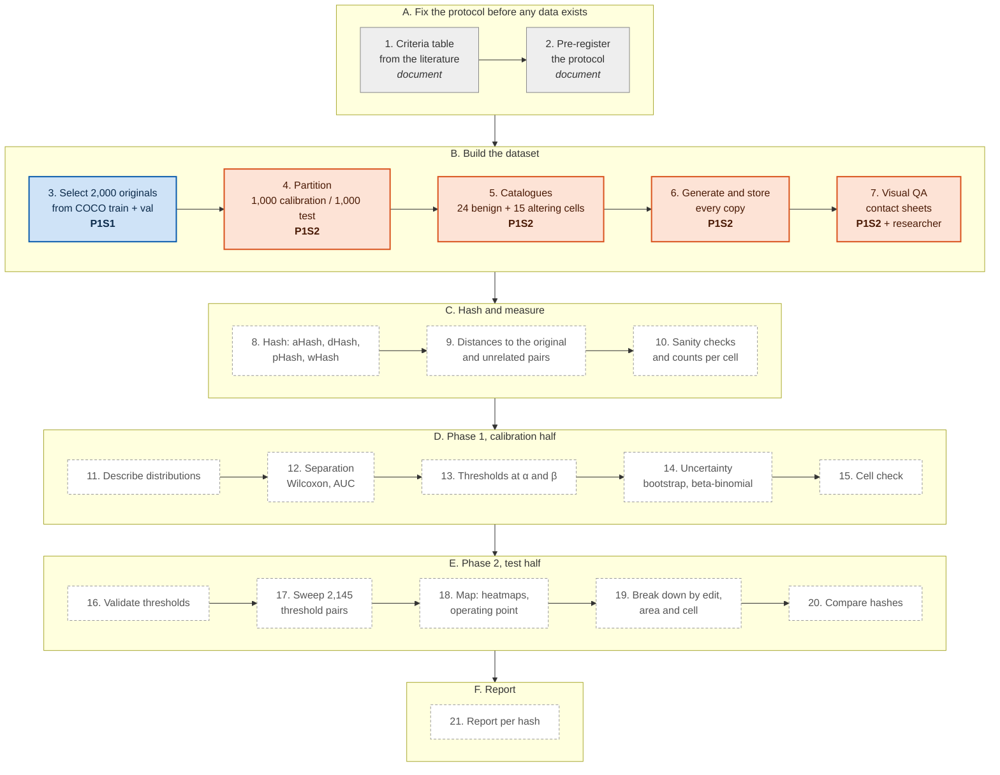
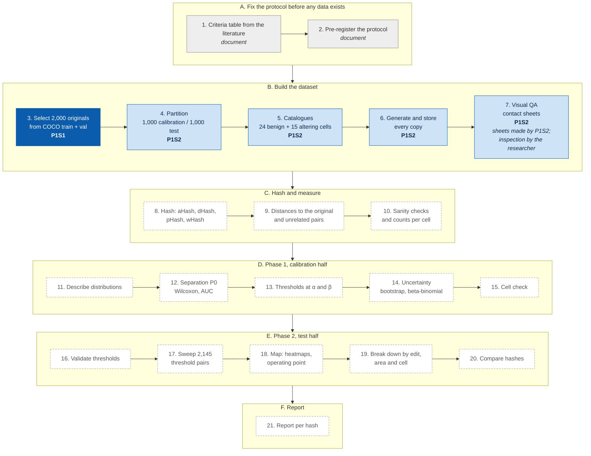

# Hamming Distance vs. Tampering Detection Accuracy of Perceptual Hashes: Experiment Protocol

Version 3 · 3 November 2026 · Jose Luis del Valle

## Introduction

### Background

A **perceptual hash** is a short fingerprint of what an image looks like. Unlike a cryptographic hash, which changes completely when a single bit of the file changes, a perceptual hash is designed to stay the same, or nearly the same, when the image is re-saved, resized or slightly adjusted. Two images are compared by counting how many bits of their fingerprints differ, the **Hamming distance**. A small distance means "looks the same"; a large distance means "looks different".

This property makes perceptual hashes attractive for **media provenance**. A device that captures or publishes a photograph can compute its fingerprint and record it, for example on a distributed ledger, at almost no cost: a 64-bit hash is 8 bytes. Later, anyone holding a copy can hash it again and compare. If the distance is small, the copy is probably the same picture, perhaps compressed or resized along the way. If the distance is large, the picture may have been edited.

The difficulty is that "looks the same" is not "says the same". Some harmless changes, such as a slight rotation, move the fingerprint noticeably. Some edits that change the meaning of a picture, such as erasing a small object, may barely move it at all. Whether the Hamming distance can separate harmless changes from content-altering edits, and where the decision lines should be drawn, has not been measured systematically for the hashes that small, low-power devices can afford to run. A systematic literature review of 56 primary studies on perceptual hashing and ledger-based provenance found no study that quantifies this trade-off.

### What the experiment does

The experiment takes **2,000 photographs** from the public COCO 2017 dataset and makes many controlled copies of each one:

- **24 benign copies**: changes that keep the content, such as JPEG and WebP re-compression, resizing, brightness and contrast changes, noise, blur, sharpening, small rotations and border crops, each at fixed strengths.
- **Up to 15 content-altering copies**: an object is inserted from another photograph, a real object is erased, or an object is duplicated within the same photograph, each covering 1, 2, 5, 10 or 20% of the image.

Each copy differs from its original by exactly one change, so any change in the fingerprint can be attributed to it. The object outlines published with COCO make it possible to place, erase and measure edits precisely.

Every original and every copy is fingerprinted with four widely used 64-bit perceptual hashes, **aHash, dHash, pHash and wHash**, and the distance between each copy and its original is recorded. The photographs are split in two halves. On the first half (calibration), the experiment describes how far each kind of change moves each hash and derives two decision thresholds. On the second half (test), it checks how those thresholds perform on photographs they have never seen, and maps how detection changes as the thresholds move.

### The decision rule

For each hash, a copy at distance *d* from its original is classified with two thresholds:

- *d* ≤ τ_low: **accept** as authentic;
- *d* > τ_high: **flag** as altered;
- otherwise: **escalate** to a stronger check or to a person.

The thresholds are chosen so that at most 5% of benign copies are flagged (false alarms) and at most 5% of altered copies are accepted (misses). Wrongly accepting an altered image is treated as the more serious error. If no lower threshold can meet the 5% miss target, because some edits leave the hash unchanged, this is reported as a finding and the rule becomes "flag above τ_high, escalate everything else".

### What the results will tell

For each of the four hashes the experiment reports how well it tolerates benign changes, how well it detects edits of each type and size, the smallest edit it reliably detects, its recommended thresholds with their uncertainty, and how it compares with the other three on the same photographs. The intended reader is the designer of a device or service that must decide which hash to use and where to set its thresholds.

### Design principles

- **One change per copy**, never combinations, so effects can be attributed.
- **Thresholds are set on one half of the data and tested on the other**, with all copies of a photograph kept in the same half.
- **Everything is pre-registered** in this protocol before the data are analysed: questions, rules, error targets and the handling of undefined thresholds.
- **Everything is reproducible**: each step is a separate open-source script that reads only the previous step's output, uses fixed random seeds, and writes records of its settings, software versions and the SHA-256 checksum of every file it produces.

### Overview of the steps

The experiment has 21 steps in six groups. The two scripts published so far carry out steps 3 to 7.



**Blue:** P1S1 ([P1S1_COCO_Dataset_Retriever](https://github.com/jdelvalle10/P1S1_COCO_Dataset_Retriever)). **Orange:** P1S2 ([P1S2_Copy_Generator](https://github.com/jdelvalle10/P1S2_Copy_Generator)). **Grey:** protocol documents. **Dashed:** scripts not yet published. Step 7 combines contact sheets drawn by P1S2 with inspection by the researcher.

## 1. Research questions

| Code | Question |
| --- | --- |
| P0 | Can the normalized Hamming distance between perceptual hashes distinguish benign transformations from edits that change the content? This is not guaranteed: the distance measures global perceptual change, not semantic change. The experiment measures how much the two kinds of distance overlap, for each hash and each kind of change. |
| Q1 | Which hash tolerates benign transformations best? |
| Q2 | Which hash detects content-altering edits best? |
| Q3 | Which hash offers the best operating point overall, taking all benign and all editing types together? |
| Q4 | Exploratory: which image characteristics make detection harder? |

## 2. Scope and limitations

These statements apply to every result of the experiment.

**Scope**

- **A threshold is not proof of integrity.** Crossing or not crossing a threshold is a screening approximation, not a guarantee that an image is authentic. The escalation band exists for this reason.
- **Hamming distance measures appearance, not meaning.** Whether it tracks semantic content is the question the experiment asks (P0); it is not assumed.
- **No compound transformations.** Each copy carries exactly one transformation.
- **No adversarial attacks.** All edits are classical (non-AI) operations, not designed to fool a specific hash.
- **Geometric changes are limited.** Flips, 90° rotations and large crops are excluded, because these four hashes are not built to survive them and they would dominate the upper threshold.
- **The contested band is not studied.** Only clearly benign and clearly content-altering changes are included.

**Limitations**

- **Copy-move at 20% is often impossible.** A copy scaled to 20% of the image often cannot be placed without overlapping its source object; in the pilot, 17 of 50 originals (34%) had no such copy.
- **Removal exists for only part of the originals,** and not a random part: only originals with an object of about the target size get a removal copy (123 of 250 cells in the pilot, 49%). Comparisons between edit types are therefore paired.
- **Unequal counts per cell.** Not-applicable cells give cells different numbers of observations. Rates use equal weight per cell, and the counts per cell and half are published.
- **Edits are easier to detect than real-world manipulations.** Classical inpainting leaves visible smears on large removals, and large pasted objects look out of context.
- **The originals are not pristine.** COCO images are JPEG files, so the re-encoding cells start from images already compressed once.
- **Rotations leave black corners**, because the canvas is kept. The corners are part of the change the hashes see; in the pilot, the 5° rotation caused most false alarms.
- **Duplicates are detected only when identical.** A re-saved or resized copy of the same photograph would not be caught.
- **One dataset.** All results come from COCO photographs; transfer to other collections is not tested.
- **Discrete distances.** A 64-bit hash gives 65 distance values, so realized error rates move in steps and rarely hit a target exactly. Exact realized rates are reported.
- **Exact pixel replication is guaranteed only in the same software environment** (section 7).
- **Licences.** COCO images carry individual Flickr licences, some of which may restrict publishing derivatives. Each original's licence id is recorded so that images can be filtered before copies are shared.

## 3. Design summary

| Element | Choice |
| --- | --- |
| Originals | 2,000 COCO 2017 photographs (train + val pool) |
| Copies per original | 24 benign + up to 15 content-altering (one per catalogue cell it can support) |
| Hashes | aHash, dHash, pHash, wHash, 64 bits each (ImageHash 4.3.2) |
| Distance | Hamming distance, counted in bits (0–64) |
| Reference pairs | 2,000 pairs of two different originals (1,000 per half), to show where "unrelated" lies |
| Split | 1,000 calibration / 1,000 test originals, decided per original; an original and all its copies stay on one side |
| Error targets | α = 5% false alarms (benign copy flagged), β = 5% misses (altered copy accepted) |
| Phase 1 | Calibration half: distance distributions, separation (P0), initial lower and upper thresholds |
| Phase 2 | Test half: validation of the Phase-1 thresholds, sweep of all 2,145 (lower, upper) pairs, operating points, hash comparison |

## 4. The 21 steps

Each step group is carried out by one script that reads only the output of the script before it.

| Step | What happens | Carried out by | State |
| --- | --- | --- | --- |
| **A. Fix the protocol before any data exists** | | | |
| 1 | Criteria table: thresholds and error rates used in the literature, to justify α and β | Document | Open |
| 2 | Pre-register: research questions, decision rule, metrics, α and β, the undefined-τ_low rule, the partition rule, number of originals, master seed | This protocol | Done |
| **B. Build the dataset** | | | |
| 3 | Select 2,000 originals from COCO train2017 + val2017 | P1S1 | Published, piloted |
| 4 | Partition: 1,000 calibration / 1,000 test, per original, seeded | P1S2 | Published, piloted |
| 5 | Catalogues: 24 benign and 15 content-altering cells | P1S2 | Published, piloted |
| 6 | Generate and store every copy; record type, strength, mask area, seed, checksum | P1S2 | Published, piloted |
| 7 | Visual QA: contact sheets for 50 random originals, inspected by the researcher; findings recorded | P1S2 (sheets) + researcher | Sheets published; inspection open |
| **C. Hash and measure** | | | |
| 8 | Hash every original and copy with the four hashes | Hashing script | Not yet published |
| 9 | Distances to the original, and 2,000 unrelated reference pairs | Hashing script | Not yet published |
| 10 | Sanity checks; counts per cell and half | Hashing script | Not yet published |
| **D. Phase 1, calibration half** | | | |
| 11 | Describe the distance distributions | Analysis script | Not yet published |
| 12 | Separation (P0): Wilcoxon, AUC | Analysis script | Not yet published |
| 13 | Thresholds at α and β; EER and Youden references | Analysis script | Not yet published |
| 14 | Uncertainty: bootstrap ranges, exact intervals, beta-binomial fit | Analysis script | Not yet published |
| 15 | Cell check: error share per cell | Analysis script | Not yet published |
| **E. Phase 2, test half** | | | |
| 16 | Validate the Phase-1 thresholds | Analysis script | Not yet published |
| 17 | Sweep all 2,145 (lower, upper) pairs, on both halves | Analysis script | Not yet published |
| 18 | Map: heatmaps, feasible region, operating point, trade-off front | Analysis script | Not yet published |
| 19 | Break down by edit type and mask area, by benign cell; image characteristics (Q4) | Analysis script | Not yet published |
| 20 | Compare the hashes (paired) | Analysis script | Not yet published |
| **F. Report** | | | |
| 21 | Report per hash; answers to P0 and Q1–Q4; limitations (section 2) | Article | Not started |

## 5. Originals and copies

**Originals (step 3, P1S1).** The pool is COCO 2017 train + val: 118,287 + 5,000 images with public object outlines. P1S1 shuffles the image ids with the master seed (20261029) and keeps, in that order, the first images that pass four rules:

1. The shorter side is at least 400 px.
2. At least one non-crowd object's filled outline covers 1–20% of the image.
3. The EXIF orientation is 1, so the outlines line up with the stored pixels.
4. Each image appears once, by COCO id and by decoded pixels.

The JPEG bytes are saved untouched. P1S2 decodes each once to 8-bit RGB and stores it as a lossless PNG: **every distance is measured against that PNG**.

**Partition (step 4, P1S2).** The sorted ids are shuffled with a seed derived from the master seed and assigned alternately to calibration and test, giving an exact 50/50 split. An original, all its copies, its splice donors and its reference pairs stay on the same side, because copies of one scene have correlated distances; mixing them across halves would make the test half look better than it is. The original is therefore the unit of every bootstrap.

**Benign catalogue (24 cells)**

| Family | Change | Levels | Implementation |
| --- | --- | --- | --- |
| Compression | JPEG re-encode | quality 90, 70, 50 | Pillow, defaults except quality |
| Compression | WebP re-encode | quality 80, 50 | Pillow, defaults except quality |
| Scaling | Resize | ×0.5, ×0.75, ×1.5 | Pillow, bicubic |
| Photometric | Brightness | +15%, −15% | Pillow ImageEnhance |
| Photometric | Contrast | +15%, −15% | Pillow ImageEnhance |
| Photometric | Gamma | 0.8, 1.2 | Lookup table, out = 255·(in/255)^γ |
| Degradation | Gaussian noise | σ = 2, 5 grey levels | NumPy, seeded, per channel, rounded and clipped |
| Degradation | Gaussian blur | σ = 0.5, 1 px | OpenCV GaussianBlur, reflect-101 border |
| Degradation | Sharpening | 100% | Unsharp mask, radius 2, threshold 0 |
| Mild geometric | Rotation | 1°, 2°, 5° | Pillow, bicubic, canvas kept, uncovered corners black |
| Mild geometric | Border crop | 2%, 5% of the area | Centred, aspect kept, sides scaled by √(1 − share) |

**Content-altering catalogue (15 cells)**

| Edit | How | Target area (% of image) |
| --- | --- | --- |
| Splice (insertion) | An object from another original in the same half, cut along its COCO outline, scaled to the target area, pasted at a random position with a Gaussian-feathered edge | 1, 2, 5, 10, 20 |
| Removal | The real object whose dilated mask is closest to the target, within 0.6–1.6× the target, is erased and filled by OpenCV Telea inpainting | 1, 2, 5, 10, 20 |
| Copy-move | An object from the same image, scaled to the target area, pasted where it does not overlap its source | 1, 2, 5, 10, 20 |

When a cell cannot be made for an original (no object of the right size for removal, or no room after 30 placement attempts), it is recorded as **not applicable** with its reason, and no copy is made.

**Fixed generation parameters**

| Parameter | Value |
| --- | --- |
| Donor and copy-move objects | Cover 1–20% of their own image |
| Paste edge | Gaussian feather, σ = 0.8 px |
| Removal mask | Dilated twice with a 3×3 kernel; the 0.6–1.6× size window applies after dilation |
| Inpainting | OpenCV Telea, radius 3 px |
| Placement attempts | Up to 30, then the cell is not applicable |
| Sharpening | Unsharp mask, radius 2, 100%, threshold 0 |
| Rotation | Canvas kept, corners black |
| Seeds | Each copy: SHA-256 of (master seed, image id, cell) |
| Storage | Every copy stored as PNG (compression level 6) with its SHA-256 |

**Measured area.** For every content-altering copy the records hold the mask share (the object's outline after scaling, or the dilated removal mask) and the changed-pixel share (all pixels that differ, including the feathered edge). **The analysis uses the mask share**; the changed-pixel share is kept as a check.

## 6. Hashing and distances (steps 8–10)

The hashing step hashes the stored files from P1S2; it does not regenerate copies. Before hashing a file it recomputes the file's SHA-256 and stops on any mismatch with the records.

| Hash | Call (ImageHash 4.3.2) | Internal steps |
| --- | --- | --- |
| aHash | `average_hash(img, hash_size=8)` | Grey, resize to 8×8, bit = pixel above the mean |
| dHash | `dhash(img, hash_size=8)` | Grey, resize to 9×8, bit = left pixel brighter than right |
| pHash | `phash(img, hash_size=8, highfreq_factor=4)` | Grey, resize to 32×32, 2-D DCT, top-left 8×8 including DC, bit = above the median |
| wHash | `whash(img, hash_size=8, image_scale=128, mode="haar")` | Grey, resize to 128×128, Haar wavelet low band, bit = above the median |

wHash's `image_scale` is fixed at 128: the library default follows each image's own size, so an original and its resized copy would otherwise be hashed at different resolutions. All four hashes receive the same decoded 8-bit RGB image.

**Distances.** For each hash: d(O, copy) in bits for every copy that was made, and d(O, O′) for 2,000 reference pairs of two different originals, 1,000 within each half. Not-applicable cells produce no distance; they are counted, not imputed.

**Sanity checks (step 10).** The lossless reference, re-read and re-hashed, gives distance 0 for every original and hash; hashing twice gives identical hashes; the counts of originals per cell and half are tabulated, and cells below a minimum count are reported as descriptive only.

## 7. Analysis

Phase 1 uses the calibration half only, Phase 2 grades on the test half, and every bootstrap resamples whole originals (2,000 resamples). The error targets are α = β = 5%.

**Threshold definitions** (k in bits, 0–64). F(k) is the false-alarm rate at k, averaged with equal weight over the 24 benign cells; a cell's rate is the share of calibration originals whose copy has a distance above k. G(k) is the miss rate at k, averaged with equal weight over the editing cells; a cell's rate is the share of originals whose copy has a distance at or below k.

τ_high = min { k : F(k) ≤ α }      τ_low = max { k : G(k) ≤ β }

- If τ_low < τ_high, the band between them is escalated.
- If τ_low ≥ τ_high, a single threshold suffices.
- **If no k meets the lower condition** (more than β of the edits already sit at distance 0), τ_low is undefined. This is reported as a finding with the editing cells responsible, and the rule becomes "flag above τ_high, escalate everything else". The pilot found this for all four hashes, so it is the expected outcome.

Equal weight per cell keeps a common change from dominating and makes small 1–2% edits count as much as large ones.

**Phase 1 (calibration half)**

| Step | Method |
| --- | --- |
| 11. Typical distances | Median, IQR, 5th and 95th percentiles of benign, altering and unrelated distances, pooled and per cell; histograms and cumulative curves |
| 12a. Do edits move the hash more? (P0) | Per original, mean altering distance minus mean benign distance; one-sided Wilcoxon signed-rank test; Bonferroni level 0.05/4 |
| 12b. How well do they separate? (P0) | AUC, pooled and per editing cell against all benign copies, with bootstrap intervals |
| 13. Initial thresholds | τ_high and τ_low as defined above; single-threshold references at the equal error rate and Youden's maximum |
| 14. Uncertainty | Thresholds re-computed on each bootstrap resample (mode and 95% range); exact Clopper–Pearson interval per cell; beta-binomial fit (n = 64) to the pooled bit counts as a smoothness check, both reported if they differ by more than one bit |
| 15. Cell check | Per benign cell, the share above τ_high; per editing cell, the share at or below τ_low; the worst cell is always reported |

**Phase 2 (test half)**

| Step | Method |
| --- | --- |
| 16. Validate | Phase-1 thresholds applied unchanged; realized false-alarm and miss rates, pooled and per cell, with intervals, next to the targets |
| 17. Sweep | Every whole-bit pair with lower ≤ upper from 0 to 64 (2,145 pairs per hash), on both halves: detection, misses, false alarms, benign acceptance, escalation per class and overall, accuracy among decided copies |
| 18. Map | Heatmaps over (lower, upper); feasible region (false alarms ≤ α and misses ≤ β); trade-off front; operating point = lowest escalation in the feasible region, chosen on calibration and reported on test with 95% intervals |
| 19. Break down | Detection by edit type and **mask area**, with a logistic fit of detection on log(area) giving the area flagged 90% of the time; false alarms by benign cell. Q4: logistic regression of each outcome on image characteristics (object count, largest-object share, Canny edge density, grey-level entropy, mean luminance, RMS contrast), standard errors clustered by original, Holm correction; exploratory |
| 20. Compare hashes | Paired, since the same originals go through every hash: paired bootstrap of differences in detection and AUC (Holm over 6 pairs); per cell, Cochran's Q across hashes and McNemar per pair (Holm) |

**Comparisons between edit types are paired:** they use only originals that have both copies being compared, because removal (and copy-move at 20%) exists only for a non-random subset of originals.

## 8. Software, records and reproducibility

| Script | Repository | Version | Steps | Tests |
| --- | --- | --- | --- | --- |
| P1S1 | [P1S1_COCO_Dataset_Retriever](https://github.com/jdelvalle10/P1S1_COCO_Dataset_Retriever) | 1.1.0 | 3 | 49, offline |
| P1S2 | [P1S2_Copy_Generator](https://github.com/jdelvalle10/P1S2_Copy_Generator) | 2.1.0 | 4–7 | 8, offline |

Both are open source under the MIT License.

**To reproduce steps 3–7** (Python 3.12 or 3.13, about 35 GB of free disk for 2,000 originals):

```
python3 -m venv .venv && source .venv/bin/activate
pip install -r P1S1_COCO_Dataset_Retriever/requirements.txt
pip install -r P1S2_Copy_Generator/requirements.txt
python3 P1S1_COCO_Dataset_Retriever/generate_dataset.py -n 2000 --split trainval -o ./originals -y
python3 P1S2_Copy_Generator/generate_copies.py --in ./originals --out ./copies
```

**Records each step writes**

| File | Step | Contents |
| --- | --- | --- |
| `run_metadata.json` | 3 and 4–7 | All settings, counts, Python and package versions, SHA-256 of the inputs and of the scripts themselves |
| `selection_log.csv` | 3 | Every image examined, its split, kept or rejected, and why |
| `images_manifest.csv` | 3 | Every saved image: split, licence id, URL, SHA-256 of the bytes, SHA-1 of the pixels |
| `manifest_originals.csv` | 4–7 | Every original: half, size, licence id, SHA-256 of the JPEG and of the PNG reference |
| `manifest_copies.csv` | 4–7 | Every (original, cell): status, parameters, target and mask share, changed-pixel share, donor or source object, attempts, seed, SHA-256 |
| `qa/contact_<id>.png` | 7 | Original and all its copies, for the visual QA |

**Reproducibility rules**

- Pinned versions: numpy 2.5.3, Pillow 12.3.0, pycocotools 2.0.11, opencv-python-headless 5.0.0.93; ImageHash 4.3.2 and PyWavelets 1.8.0 for hashing.
- All steps run in one environment, whose exact package list is published with the results.
- Each script checks the checksums written by the previous one and stops on any mismatch.
- P1S2's output does not depend on the number of worker processes, and an interrupted run resumes to identical output.
- On another machine or library version, JPEG/WebP codecs and OpenCV may produce slightly different pixels; this has not been measured. The recorded checksums and versions make any difference detectable and traceable, and the analysis always uses the stored files.

## 9. Pilot results

Two pilots have been run.

**Pilot of P1S1 + P1S2** (50 originals from val2017, both scripts as published, no failures)

- **Selection:** 73 images examined to keep 50 (68%): 16 rejected for a short side under 400 px, 7 for no object covering 1–20%. About 2,900 images will be examined to keep 2,000.
- **Copies:** 1,799 written in 7.9 s; 151 of 1,950 cells not applicable (127 removal, 24 copy-move, 17 of them at 20%). All 1,200 benign copies and all 250 splices were made.
- **Integrity:** SHA-256 recomputed for all 1,799 copies: no mismatch, none missing.
- **Disk:** 28 MB for step 3 and 883 MB for steps 4–7, which extrapolates linearly to about 35 GB for 2,000 originals.

| Edit | Copies | Mask share ÷ target, min | Median | Max |
| --- | --- | --- | --- | --- |
| Splice | 250 | 0.986 | 1.000 | 1.022 |
| Copy-move | 226 | 0.979 | 1.000 | 1.017 |
| Removal | 123 | 0.610 | 0.957 | 1.574 |

**End-to-end analysis pilot** (88 originals, prototype code, before the generation parameters were fixed). Thresholds from the calibration half, graded on the test half:

| Hash | τ_high (bits) | Altered copies at distance 0 | τ_low | Test false alarms | Test detection | Escalated overall |
| --- | --- | --- | --- | --- | --- | --- |
| aHash | 3 | 22.5% | undefined | 7.3% | 39.8% | 76.5% |
| dHash | 6 | 12.5% | undefined | 5.3% | 25.8% | 84.5% |
| pHash | 6 | 10.0% | undefined | 5.4% | 48.5% | 73.1% |
| wHash | 4 | 31.8% | undefined | 4.6% | 34.2% | 80.6% |

The lower threshold was undefined for all four hashes, mostly because of 1–2% edits that leave the hash unchanged. The 5° rotation accounted for most false alarms. These pilot rates are too imprecise to rank the hashes.

## 10. Version history

| Version | Date | Changes |
| --- | --- | --- |
| 3 | 3 Nov 2026 | Generation parameters fixed after the pilot, including the inpainting radius and the removal size window applied after dilation; mask area defined as the edited area; comparisons between edit types paired; copy-move at 20% reported as a limitation; copies stored on disk and hashed after checksum verification; one script per step group with auditable records |
| 2 | 29 Oct 2026 | Research questions P0 and Q1–Q4; every original receives every catalogue cell; 2,000 originals from COCO train + val; no compound transformations; partition per original; α = β = 5% |
| 1 | Oct 2026 | One benign and one content-altering copy per original, 1,000 originals |

## 11. Open items

- [ ] Criteria table from the literature (step 1).
- [ ] Minimum number of observations for a cell to be analysed rather than only described.
- [ ] Visual inspection of 50 contact sheets (step 7).
- [ ] Full run of steps 3–7 on 2,000 originals.
- [ ] Hashing script (steps 8–10) and analysis scripts (steps 11–20).
- [ ] A later study varying the error targets α and β.


# P1S1 Dataset Generator

Downloads COCO 2017 images that meet the protocol v2 selection rules, from the terminal.

    python3 -m venv .venv && source .venv/bin/activate
    python3 -m pip install -r requirements.txt     # pinned versions
    python3 generate_dataset.py                 # asks for each setting; Enter keeps the default
    python3 generate_dataset.py -n 500 -s 400 -o ~/COCOSubset      # no questions
    python3 generate_dataset.py --help

## Where this script sits in the experiment

The 21 steps of the experiment protocol (final version, approved 29 October 2026). Each script reads only the output of the script before it.



**Dark blue:** this repository (P1S1 · P1S1_COCO_Dataset_Retriever), protocol step 3. **Light blue:** the other finished script (P1S2 · P1S2_Copy_Generator), steps 4, 5, 6, 7. **Grey:** protocol documents, not scripts. **Dashed:** scripts not written yet. Step 7 is partly automated: P1S2 draws the contact sheets and the researcher inspects them.

## Usage

Settings: number of images (`-n`), minimum short side in px (`-s`), COCO pool (`--split val|train|trainval`;
`val` has 5,000 images and is enough for a few hundred; `train` and `trainval` need the much larger train
annotation file and ask for confirmation unless `-y`), seed (`--seed`), output folder (`-o`, must have no
images yet). The first run downloads the COCO annotation zip (about 250 MB) into `OUT/annotations/`; later
runs reuse it. Ctrl+C cancels cleanly and keeps the images already saved, with their labels.

The protocol's pool is train2017 + val2017:

    python3 generate_dataset.py -n 2000 --split trainval -o ~/COCOProtocol -y

Rules: short side >= the chosen minimum; at least one non-crowd object whose filled outline covers
1-20% of the image; EXIF orientation 1; each image once (by COCO id and by pixel content).

Output: `OUT/images/*.jpg` (original bytes, untouched), `OUT/labels/*.txt` (YOLO segmentation,
format read by `run_pilot.py`), `OUT/classes.txt`, `OUT/selection_log.csv` (why each image examined
was kept or rejected, and its split), `OUT/images_manifest.csv` (one row per saved image: order, id,
split, size, licence id, URL, SHA-256 of the saved bytes, SHA-1 of the decoded pixels),
`OUT/run_metadata.json` (settings, result counts, SHA-256 of the annotation files, of the output
tables and of the two scripts, Python and package versions). The same seed and settings give the
same images; `val` and `train` select exactly what version 1.0 selected.

Exit codes: 0 finished, 1 error or invalid settings, 130 cancelled.

Tests (no network): `python3 -m unittest discover -s tests -v`

Files: `dataset_core.py` (selection and download logic), `generate_dataset.py` (terminal interface),
`tests/test_core.py`, `tests/test_cli.py`.

## Author and license
Author: Jose Luis del Valle (joseluisdelvalle@gmail.com).
Open source under the MIT License; see the `LICENSE` file.
